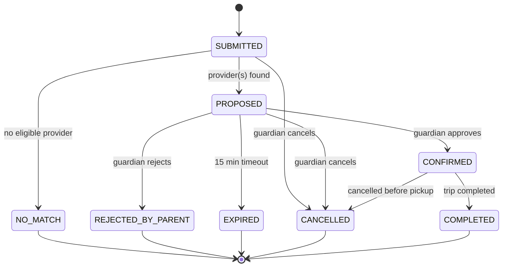
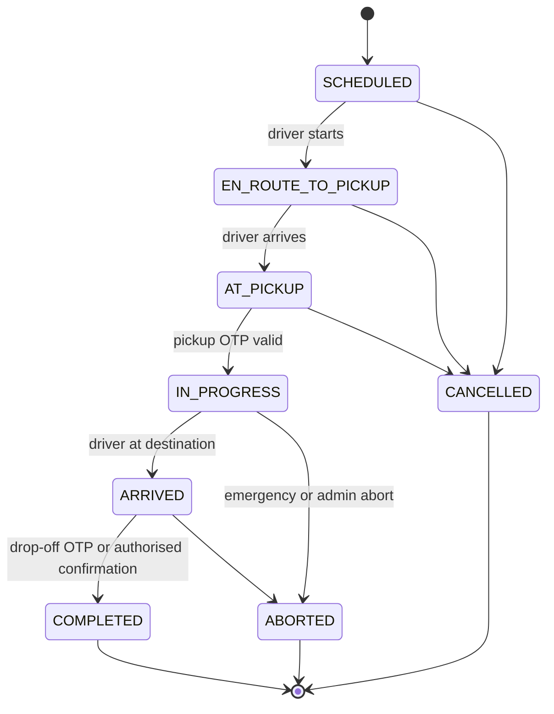

# SETU — Functional Requirements Document (FRD)

| Field | Value |
|---|---|
| Version | 0.1 DRAFT · 13 Nov 2026 |
| Companion | SETU_PRD.md, SETU_TRD.md, SETU_REQUIREMENTS_TRACEABILITY.md |
| Priorities | **P0** critical MVP · **P1** important enhancement · **P2** production/future |

**Requirement block format.** Each requirement lists: *Actor · Pre (preconditions) · Trigger · Main · Alt · Fail · In · Out · Rules · AC (acceptance criteria)*. Rules reference the catalogue in §B. Test cases (TC-*) are in §H and the Traceability file.

**Roles:** `GUARDIAN`, `STUDENT_ADULT` (P1), `DRIVER` (provider user), `PROVIDER_ADMIN` (P2; MVP: driver is own provider), `INSTITUTION_STAFF`, `ADMIN`, `SAFETY_ADMIN`, `OPERATOR` (disruption reporter; MVP may be played by ADMIN).

---

## A. Functional Requirements by Module

### Module 1 — Authentication & Authorisation

**FR-AUTH-001 Registration (P0)**
- Actor: Guardian, Driver, Institution staff (staff created by admin in MVP).
- Pre: email/phone not registered. Trigger: submit registration form.
- Main: validate → hash password → create user with role → send verification-less welcome email [MVP: no email verification; P1 add] → redirect to login.
- Alt: Driver registration continues to provider profile (FR-PROV-001).
- Fail: duplicate email (409), weak password (422), invalid phone (422).
- In: name, email, phone (E.164, +91 default), password, role (GUARDIAN or DRIVER only for self-registration), consent-to-terms flag.
- Out: user id, role. Rules: BR-010 role whitelist; passwords ≥ 10 chars, not common.
- AC: self-registering as ADMIN is rejected (403); stored password is a hash; duplicate email rejected.

**FR-AUTH-002 Login (P0)** — Actor: any. Pre: account ACTIVE. Main: verify credentials → create server-signed session → return role & redirect. Fail: bad credentials generic message (401), suspended account (403), rate limit exceeded (429 after 5 failures / 15 min / account+IP). AC: failed login never reveals whether email exists; session cookie `HttpOnly`, `SameSite=Lax`.

**FR-AUTH-003 Logout (P0)** — Main: invalidate session; Out: 204. AC: subsequent API call returns 401.

**FR-AUTH-004 Password reset (P1)** — Trigger: "forgot password". Main: issue single-use token (hash stored, 30-min expiry) → email link → set new password → invalidate sessions. Alt: unknown email returns the same response. Fail: expired/used token (400). AC: token reuse rejected.

**FR-AUTH-005 Role management (P0)** — Actor: ADMIN. Main: assign/change roles; audit logged. Fail: non-admin 403. AC: role change appears in audit_logs.

**FR-AUTH-006 Session management (P0)** — Idle timeout 30 min (admin 15), absolute 12 h [ASM]; driver sessions during active trip extend. AC: expired session → 401.

**FR-AUTH-007 Access control (P0)** — Every API verifies authentication, role, **and object ownership** (see Permission matrix §C). AC: guardian A requesting guardian B's student → 404 (not 403, to avoid enumeration) [REC].

### Module 2 — Parent/Guardian Management

**FR-PAR-001 Guardian profile (P0)** — Actor: Guardian. View/edit name, phone, address (optional), notification preferences (email). Rules: email change requires re-auth. AC: updates persisted; others' profiles inaccessible.

**FR-PAR-002 Manage multiple students (P0)** — Guardian adds/edits/archives multiple students (see FR-STU). AC: list shows only own students.

**FR-PAR-003 Parent dashboard (P0)** — Shows: students, active trip banner, pending consent requests, recent journeys, disruption alerts. AC: active trip appears within 5 s of IN_PROGRESS.

**FR-PAR-004 Saved locations (P1)** — Save named pickup/destination points (home, school). Rules: coordinates within configured service-area bounding box [ASM].

### Module 3 — Student Management

**FR-STU-001 Create/edit student profile (P0)**
- Actor: Guardian. In: first name, class/standard or course, date of birth (or age category), institution id, optional notes (medical/allergy — P1, minimal), default pickup.
- Main: validate → derive `age_category` (MINOR_PRIMARY <11, MINOR_SECONDARY 11–17, ADULT ≥18) → save with `guardian_id`.
- Fail: missing institution (422). Rules: BR-001, BR-011 (minimal data). AC: age category derived correctly at boundaries (10/11/17/18).

**FR-STU-002 Student status (P0)** — ACTIVE / INACTIVE / ARCHIVED; inactive students cannot be requested for rides. Institution affiliation link maintained via `institution_id`.

**FR-STU-003 Adult student self-management (P1)** — Adult (≥18) may hold own account subject to institution policy flag; guardian consent not required if `institution.allows_adult_self_booking`. Fail otherwise.

### Module 4 — Institution Management

**FR-INST-001 Institution registration (P0 seeded / P1 UI)** — Admin creates institution: name, type (SCHOOL/PU/COLLEGE), address, coordinates, contact. MVP seeds 2 institutions.
**FR-INST-002 Institution verification (P1)** — status PENDING/VERIFIED/SUSPENDED; only VERIFIED institutions selectable by guardians. MVP seeds as VERIFIED (**simulated**, labelled).
**FR-INST-003 Staff roles (P0 minimal)** — INSTITUTION_STAFF users linked via `users.institution_id`; can view expected arrivals for own institution only.
**FR-INST-004 Arrival confirmation (P0)** — Actor: Institution staff. Pre: trip ARRIVED at institution destination. Main: staff of the destination institution can (a) view the drop-off OTP and read it to the driver, who enters it (TR-API-066/067), or (b) directly confirm handover (TR-API-068, recorded as `STAFF_CONFIRM`); backend completes drop-off (FR-TRIP-006). Fail: wrong institution (403); trip not ARRIVED (409). AC: staff of another institution can neither view the OTP nor confirm.

### Module 5 — Provider & Driver Management

**FR-PROV-001 Provider/driver registration (P0)** — In: category (SCHOOL_APPROVED / COMMUNITY), driver name, licence number, licence expiry, licence class, phone. Out: driver record `PENDING`. Fail: duplicate licence (409); expired licence (422).
**FR-PROV-002 Vehicle registration (P0)** — In: registration number (format-validated), type (BUS/VAN/AUTO), `permitted_capacity` (students; 1–60), permit/fitness/insurance expiry dates, home base coordinates, service radius. Out: vehicle `PENDING`. Rules: BR-003.
**FR-PROV-003 Document submission (P1; P0 = metadata only)** — Upload metadata/file (PDF/JPG ≤ 5 MB) for licence, RC, insurance, permit, police clearance. MVP stores document type + number + expiry only; files P1. Files stored outside web root, private.
**FR-PROV-004 Verification workflow (P0)** — Admin queue lists PENDING drivers/vehicles → reviews → APPROVE or REJECT (reason mandatory) → status & audit entry → provider emailed. **Prototype banner: "SIMULATED VERIFICATION — no real document/police/RTO check performed."** AC: approve/reject recorded with admin id; unapproved never matched.
**FR-PROV-005 Suspension and expiry (P1; expiry check P0)** — Admin may SUSPEND any time; system treats provider/vehicle with any expired mandatory date as ineligible at match time (P0) and via nightly job (P1). AC: expired insurance date → excluded from matching.
**FR-PROV-006 Driver availability (P0)** — Driver toggles AVAILABLE/UNAVAILABLE and sets availability window per date; matching respects it.

### Module 6 — Transport Disruption Management

**FR-DISR-001 Record disruption (P1)** — Actor: OPERATOR/ADMIN. In: route/stop name, type (CANCELLED/DELAYED/ROUTE_DISRUPTED/OVERCROWDED), start/end time, affected stop ids or route id, free-text note. **No government API assumed**; manual workflow. Out: disruption id.
**FR-DISR-002 Identify affected parents (P1)** — Match disruption to students whose saved route/stop (`students.default_route_id` or pickup within 500 m of affected stop [ASM]) → list affected guardians. AC: only matching students' guardians selected.
**FR-DISR-003 Parent notification (P1)** — Email + dashboard banner with link to create ride request prefilled. Email excludes student name (uses "your child").
**FR-DISR-004 Disruption history (P1)** — view/close disruptions.
*(MVP fallback: ADMIN may trigger a "demo disruption" button that notifies the demo guardian.)*

### Module 7 — Location & Map Management

**FR-LOC-001 Pickup/destination selection (P0)** — Leaflet map; click/drag marker; optional "use my location" (Geolocation, explicit permission); search box [P1, avoid hammering Nominatim — see TRD]. Out: lat/lng (6 dp), label.
**FR-LOC-002 Coordinate storage & validation (P0)** — lat ∈ [-90,90], lng ∈ [-180,180], within service area bounding box [ASM]; pickup ≠ destination (> 100 m apart). Fail: out of area (422).
**FR-LOC-003 Review before confirm (P0)** — Summary map + addresses before submission.
**FR-LOC-004 Map display (P0)** — Tiles with attribution "© OpenStreetMap contributors". AC: attribution visible.

### Module 8 — Ride Request Management

**FR-RIDE-001 Create ride request (P0)** — Actor: Guardian. Pre: student ACTIVE & owned. In: student_ids[1..n], pickup, destination, travel date (≥ today), required pickup time, optional `disruption_id`, `shared_ok` flag. Main: validate → status SUBMITTED → run matching → PROPOSED or NO_MATCH. Fail: time in past (422), other family's student (404).
**FR-RIDE-002 Request status (P0)** — States per §F. Guardian can view timeline.
**FR-RIDE-003 Cancellation (P0)** — Guardian may cancel until trip IN_PROGRESS; frees capacity; notifies driver. Fail: after pickup (409).
**FR-RIDE-004 Time selection & expiry (P0)** — Proposal expires after 15 min [ASM] → EXPIRED; requests for past times rejected. Pickup window: ± 10 min tolerance [ASM].
**FR-RIDE-005 Parent approval (P0)** — see FR-CONS.

### Module 9 — Ride Matching & Allocation

**FR-MATCH-001 Provider eligibility (P0)** — Candidate must be: driver APPROVED & unexpired licence; vehicle APPROVED & permit/insurance/fitness unexpired on travel date; provider AVAILABLE; not SUSPENDED. AC: any violation excludes candidate (test per condition).
**FR-MATCH-002 Capacity (P0)** — remaining = `permitted_capacity − reserved_seats(allocations on overlapping trips)`; require `remaining ≥ num_students`. Executed inside a DB transaction with row lock (`SELECT … FOR UPDATE` on vehicle). AC: concurrent requests cannot overbook.
**FR-MATCH-003 Route & time compatibility (P0)** — pickup within vehicle `service_radius_km` of vehicle base or current location (Haversine); destination within `max_detour_km` of provider's operating area [ASM]; no overlapping trip for the vehicle in [pickup_time − 15 min, estimated_end + 15 min].
**FR-MATCH-004 Ranking (P0)** — Score = 0.4·proximity + 0.25·time-fit + 0.2·capacity-fit + 0.15·category-preference (SCHOOL_APPROVED slightly preferred when institution matches) — weights configurable. Return top 3.
**FR-MATCH-005 Shared rides (P1)** — Group compatible requests (pickup ≤ 1.5 km apart, same destination area ≤ 1 km, time windows overlap ≤ 15 min, combined students ≤ capacity, all guardians opt-in `shared_ok`, same institution, no safeguarding conflicts such as mixed adult/primary unless policy allows [ASM]).
**FR-MATCH-006 Allocation confirmation (P0)** — Allocation row created with status PROPOSED holding seats for 15 min; becomes CONFIRMED on consent; released on reject/expire.

### Module 10 — Guardian Consent

**FR-CONS-001 Consent request (P0)** — On PROPOSED, guardian sees: provider (first name + category), vehicle type, registration (masked middle), capacity, approved status, pickup/destination, time, tracking and OTP explanation. Email notification link.
**FR-CONS-002 Approve (P0)** — Guardian explicitly confirms (checkbox + button; re-auth if idle > 5 min). Records consent (who, when, IP, text version, allocation id). → trip created, driver assigned. Rule: BR-001.
**FR-CONS-003 Reject (P0)** — Records rejection; allocation released; offer next candidate or NO_MATCH.
**FR-CONS-004 Consent history (P1)** — List all consents per student.
**FR-CONS-005 Validation before assignment (P0)** — Trip creation endpoint rejects without `guardian_consents.status = APPROVED` for **every** student on trip. AC: attempt via direct API call fails 409.

### Module 11 — Trip & Journey Management

**FR-TRIP-001 Trip creation (P0)** — Created on consent; status SCHEDULED; stores route snapshot (polyline) and corridor parameters.
**FR-TRIP-002 Driver assignment view (P0)** — Driver sees pickup, destination, time, student first names (minimal), guardian contact (masked/call-via-app P2), instructions. Only after consent.
**FR-TRIP-003 Status machine (P0)** — SCHEDULED → EN_ROUTE_TO_PICKUP → AT_PICKUP → IN_PROGRESS → ARRIVED → COMPLETED; CANCELLED/ABORTED from non-terminal states. Invalid transitions rejected (409).
**FR-TRIP-004 Pickup verification (P0)** — Pre: AT_PICKUP; driver within 300 m of pickup (GPS-based soft check; override reason logged). Main: driver requests OTP check → enters 6-digit OTP provided by guardian/authorised person → backend validates (hash, expiry 10 min, single use, ≤ 5 attempts) → records timestamp/location → IN_PROGRESS → email guardian. Alt: approved handover override by ADMIN with reason (audited). Fail: invalid (400, attempts remaining), expired (410), locked (423).
**FR-TRIP-005 Journey start/tracking start (P0)** — Starting is the effect of FR-TRIP-004; driver client begins GPS posting.
**FR-TRIP-006 Drop-off verification (P0)** — Pre: ARRIVED (driver within 300 m of destination) . Main: authorised adult/institution staff provides drop-off OTP (generated per trip/destination) → validate → COMPLETED, record time/location → notify guardian. Rule: BR-005 **destination proximity alone never completes a trip for minors.** Alt: ADMIN override with reason. Fail: as pickup.
**FR-TRIP-007 Journey completion & close-out (P0)** — Tracking visibility ends; summary stored; capacity released.
**FR-TRIP-008 Driver decline/cancel (P1)** — Driver may decline before EN_ROUTE; triggers re-match with guardian re-consent.

### Module 12 — GPS Tracking

**FR-GPS-001 Collection (P0)** — Driver browser uses `watchPosition` (high accuracy) during EN_ROUTE_TO_PICKUP..ARRIVED; shows on-screen "Tracking ON" and warns that closing/locking screen stops tracking; requests wake lock where supported. **Foreground only (P0 limitation).**
**FR-GPS-002 Submission (P0)** — POST every 5 s (configurable; throttle 5–15 s) with lat, lng, accuracy, speed, heading, client timestamp. Batch-flush queued points after reconnect (≤ 50).
**FR-GPS-003 Validation (P0)** — Server validates: driver owns trip, trip in trackable state, numeric bounds, accuracy ≤ 1000 m stored (> 100 m flagged low-quality), client timestamp within ±120 s of server (else flagged), implied speed ≤ 120 km/h (else flagged "implausible"), duplicate suppression. Server time is authoritative.
**FR-GPS-004 Storage (P0)** — `location_updates` table; indexes on (trip_id, recorded_at).
**FR-GPS-005 Parent map view (P0)** — Poll `/trips/{id}/location/latest` every 5 s (WebSocket/SSE P2); show marker, accuracy circle, planned route, "Last updated" time, stale warning after 60 s.
**FR-GPS-006 Last known location & tracking failure (P0)** — If no ping > 90 s during IN_PROGRESS → `SIGNAL_LOST` event; parent sees last known position with timestamp; > 5 min → admin alert (P1 incident).
**FR-GPS-007 Demo simulation (P0, prototype only)** — Driver page "Simulate drive" posts interpolated points along route; "Simulate deviation" posts points off-corridor. Clearly labelled SIMULATION; flagged `is_simulated=1`.

### Module 13 — Route Deviation & Safety Engine

**FR-SAFE-001 Route corridor (P0)** — Corridor = polyline buffer of `corridor_radius_m` (default 500 m; 150 m urban [ASM]).
**FR-SAFE-002 GPS accuracy handling (P0)** — Pings with accuracy > `max_accuracy_m` (default 100) are stored but excluded from deviation counting.
**FR-SAFE-003 Deviation threshold & persistence (P0)** — A deviation is *persistent* when ≥ `N=3` consecutive accurate pings lie outside the corridor **and** the span ≥ `T=120 s` (demo: 20 s) **or** max distance ≥ `D=2 km`. Returning inside corridor resets the counter and logs "deviation cleared".
**FR-SAFE-004 Driver reason prompt (P1)** — On SUSPECTED deviation, driver client prompts: TRAFFIC / ROAD_CLOSURE / PICKUP_ADDRESS_CHANGE / EMERGENCY / OTHER. Reason stored; **does not clear the incident** by itself.
**FR-SAFE-005 Incident creation (P0)** — On persistent deviation → incident `OPEN` with severity per §E, link to trip, last location, timeline.
**FR-SAFE-006 Notifications (P0)** — MEDIUM: guardian + safety admin. HIGH: + escalation checklist. LOW: dashboard only.
**FR-SAFE-007 Acknowledge / review (P0 acknowledge; P1 console)** — SAFETY_ADMIN acknowledges (assigns self), views location, timeline, vehicle, driver, guardian contact.
**FR-SAFE-008 Escalate (P1)** — Admin records escalation: "112 contacted manually by <admin> at <time>, reference <text>". **System makes no automatic police contact.**
**FR-SAFE-009 Resolve (P1)** — Resolution types: FALSE_ALARM, TRAFFIC_OR_ROAD, DRIVER_EXPLAINED, SAFETY_CONCERN_CONFIRMED, EMERGENCY_HANDLED; notes mandatory.
**FR-SAFE-010 SOS / parent concern (P1)** — Driver SOS and parent "Report concern" create incidents with severity HIGH/MEDIUM and immediate admin alert.
**FR-SAFE-011 Classification (P0)** — Incident `cause_hint` ∈ {GPS_ERROR_SUSPECTED, SIGNAL_LOSS, TRAFFIC_DIVERSION (driver-reported), ROAD_CLOSURE, UNEXPLAINED_PERSISTENT_DEVIATION, EMERGENCY_REPORTED}; the engine only auto-sets UNEXPLAINED_PERSISTENT_DEVIATION or SIGNAL_LOSS; humans set others. **No automatic "kidnapping" label.**

### Module 14 — Email Notifications

**FR-NOTIF-001 Templates (P0)** — Templates: DISRUPTION, RIDE_CONFIRMATION(PROPOSAL), CONSENT_REQUEST, PROVIDER_ASSIGNED, PICKUP_CONFIRMED, ROUTE_DEVIATION, INCIDENT_UPDATE, DROPOFF_CONFIRMED. Content: status + secure link; no OTP in email by default [REC]; minimal PII.
**FR-NOTIF-002 Event triggers (P0)** — Service layer emits events → notification rows → sender.
**FR-NOTIF-003 Recipient validation (P0)** — Only verified-format email of the linked guardian/admin; no free-form recipients.
**FR-NOTIF-004 Delivery status & retry (P0/P1)** — States QUEUED/SENT/FAILED; background thread sends; retry up to 3× with backoff; failures logged; **failure never blocks core flow**.
**FR-NOTIF-005 In-app notifications (P0)** — Mirror in dashboard so users still see events if email fails.

### Module 15 — Admin Dashboard

**FR-ADM-001 User management (P0 list/suspend)** · **FR-ADM-002 Provider/vehicle approval (P0)** · **FR-ADM-003 Trip monitoring (P0)**: live list with status & last ping · **FR-ADM-004 Incident monitoring (P0)** · **FR-ADM-005 Audit history (P1; P0 write)** · **FR-ADM-006 Disruption entry (P1)** · **FR-ADM-007 Handover override (P1)**. AC: admin actions all produce audit_logs rows.

### Module 16 — AI Assistant & Analytics

**FR-AI-001 Gemini assistant (P1)** — Guardian chat explaining statuses, features, disruption messages. System prompt forbids approvals/consent/allocation/severity; backend passes only the guardian's own minimal context; output labelled "AI-generated explanation". Timeout 8 s; fallback canned text. AC: with API key unset, endpoint returns fallback and all core flows unaffected.
**FR-AI-002 Disruption/journey explanation (P1)** — Plain-language summaries from structured data.
**FR-AI-003 Demand analysis (P1)** — SQL aggregates: top pickup grid cells, frequent disrupted routes, peak hours, unmet requests (NO_MATCH rate). Display as table/bar chart. ML only [FUTURE].
**FR-AI-004 Recommendations (P2)** — Suggest supply gaps to admins (advisory).

### Module 17 — Reporting & History

**FR-RPT-001 Previous journeys (P0 basic)** — Guardian list with status/time. **FR-RPT-002 Disruption history (P1)** · **FR-RPT-003 Provider history (P1)** · **FR-RPT-004 Incident history (P1)** · **FR-RPT-005 Basic analytics (P1)**.

---

## B. Business Rules Catalogue

| ID | Rule |
|---|---|
| BR-001 | Trips involving minors require recorded, approved guardian consent for each student before assignment |
| BR-002 | Only APPROVED driver+vehicle with unexpired mandatory documents are eligible |
| BR-003 | Seats reserved ≤ `permitted_capacity`; one non-student seat reserved for driver is not counted in capacity [ASM] |
| BR-004 | Pickup OTP: 6 digits, ≤ 10 min, single-use, ≤ 5 attempts |
| BR-005 | Drop-off needs OTP/authorised confirmation for minors; proximity alone is insufficient |
| BR-006 | Location visible only to the student's guardian(s), the assigned driver, authorised admins, and only while trip trackable |
| BR-007 | A single GPS point never creates an incident |
| BR-008 | AI never approves, consents, allocates, or sets emergency severity |
| BR-009 | Emails contain minimal data + secure link; secrets only in env vars |
| BR-010 | Self-registration roles limited to GUARDIAN and DRIVER |
| BR-011 | Collect only necessary student data |
| BR-012 | SETU makes no automatic police contact; 112 escalation is manual |
| BR-013 | Proposals hold seats 15 min then expire |
| BR-014 | Ride requests only for ACTIVE students of VERIFIED institutions |
| BR-015 | Parent cannot approve/request for students not linked to them |
| BR-016 | All admin/safety actions are audit logged |
| BR-017 | Prototype verification must be labelled SIMULATED |
| BR-018 | Tracking GPS posts accepted only for the assigned driver and trackable trip states |
| BR-019 | Shared rides require opt-in of every guardian |
| BR-020 | Core flows must not depend on Gemini or email availability |

## C. Role–Permission Matrix

Legend: C create · R read · U update · D delete · — none · *own* = only own/linked records · *asg* = only assigned

| Resource | GUARDIAN | DRIVER | INSTITUTION_STAFF | ADMIN | SAFETY_ADMIN |
|---|---|---|---|---|---|
| Own user profile | R U | R U | R U | R U | R U |
| Users (all) | — | — | — | R U (suspend) | R |
| Students | C R U *own* | R *asg (minimal)* | R *own institution* | R | R |
| Institutions | R | — | R *own* | C R U | R |
| Providers/Drivers | R (*proposed only*, limited) | C R U *own* | — | R U (approve/reject/suspend) | R |
| Vehicles | R (*proposed only*) | C R U *own* | — | R U | R |
| Disruptions | R *affected* | — | R | C R U | R |
| Ride requests | C R U(cancel) *own* | — | — | R | R |
| Allocations/proposals | R *own* | R *asg* | — | R | R |
| Consents | C R *own* | — | — | R | R |
| Trips | R *own students* | R U(status) *asg* | R *arriving at own institution* | R | R |
| Pickup OTP | R (generate/view) *own* | Submit *asg* | — | Override | — |
| Drop-off OTP | R (view) *own* | Submit *asg* | View OTP + direct confirm *own institution* | Override | — |
| GPS submit | — | C *asg active* | — | — | — |
| GPS read | R *own active trip* | R *own asg* | — | R | R |
| Incidents | Create concern *own* / R *own* | SOS / reason | — | R U | R U (ack/resolve/escalate) |
| Notifications | R *own* | R *own* | R *own* | R | R |
| Audit logs | — | — | — | R | R |
| Analytics | — | — | — | R | R |
| AI assistant | Use | — | — | Use | — |

## D. Use-Case List

| ID | Use case | Actor |
|---|---|---|
| UC-01 | Register guardian | Guardian |
| UC-02 | Add student | Guardian |
| UC-03 | Register provider/vehicle | Driver |
| UC-04 | Approve/reject provider | Admin |
| UC-05 | Record disruption | Operator/Admin |
| UC-06 | Request alternative ride | Guardian |
| UC-07 | Review proposal & consent | Guardian |
| UC-08 | Accept assignment/view trip | Driver |
| UC-09 | Perform pickup with OTP | Driver + Guardian/authorised person |
| UC-10 | Share live location | Driver |
| UC-11 | Track child's journey | Guardian |
| UC-12 | Detect deviation & raise incident | System |
| UC-13 | Review/acknowledge/escalate incident | Safety admin |
| UC-14 | Drop-off handover | Driver + Institution staff/guardian |
| UC-15 | Receive notifications | Guardian |
| UC-16 | Ask AI assistant | Guardian |
| UC-17 | View demand analytics | Admin |
| UC-18 | Cancel request | Guardian |

**Use-case descriptions (key):**
- **UC-06**: Guardian selects student(s), pickup/destination on map, date/time → system validates → matching → proposal(s). *Postcondition:* request PROPOSED or NO_MATCH.
- **UC-07**: Guardian reviews provider/vehicle → approves (creates trip) or rejects (release seats). *Postcondition:* consent record exists.
- **UC-09**: Driver at pickup → guardian gives OTP → backend validates → IN_PROGRESS → email. *Exception:* wrong OTP ×5 locks until admin override.
- **UC-12**: Each GPS ping evaluated by engine; persistent out-of-corridor → incident OPEN → notifications.
- **UC-14**: Driver at destination → institution staff/authorised adult enters OTP → COMPLETED → email.

## E. Incident Severity Workflow

| Severity | Trigger (auto unless stated) | Actions |
|---|---|---|
| INFO | Single out-of-corridor point; low-accuracy points; brief signal gap < 90 s | Log event only |
| LOW | Signal lost 90 s–5 min; deviation cleared quickly | Dashboard note to guardian |
| MEDIUM | Persistent deviation (FR-SAFE-003) **or** signal lost > 5 min during IN_PROGRESS | Create incident; email guardian + safety admin; request driver reason |
| HIGH | MEDIUM persisting > 10 min with no driver reason/contact **or** deviation > 5 km **or** driver SOS **or** guardian concern | + escalation checklist to safety admin; production: phone call/SMS |
| CRITICAL | **Manual only** (safety admin judgement/credible emergency report) | Admin documents manual 112 escalation; guardian contacted by authorised channel |

## F. State Transition Diagrams

## G. Validation Rules

| Field | Rule |
|---|---|
| email | RFC-5322 basic regex, ≤ 254, unique, lower-cased |
| phone | E.164; Indian mobile `^\+91[6-9]\d{9}$` default |
| password | ≥ 10 chars, not in common-password list, ≠ email |
| name | 1–100 chars, letters/space/.'- |
| coordinates | numeric, in range, in service-area bbox, 6 dp |
| date/time | ISO 8601; ≥ now + 15 min; ≤ now + 30 days |
| vehicle reg. | `^[A-Z]{2}\d{1,2}[A-Z]{0,3}\d{4}$` (uppercased, spaces stripped) |
| capacity | integer 1–60 |
| OTP | `^\d{6}$` |
| GPS accuracy | ≥ 0 number; > 1000 rejected from deviation & flagged |
| enum fields | must be in allowed set |

**Error scenarios:** invalid credentials; expired session; duplicate registration; student not owned; no match; consent expired; capacity race lost (409); OTP invalid/expired/locked; GPS posted by non-assigned driver (403); trip in wrong state (409); email failure (logged, non-blocking); Gemini timeout (fallback); map tile load failure (show coordinates list); geolocation permission denied (manual pin).

**Edge cases:** two parents booking last seat simultaneously; driver loses signal in tunnel; GPS jitter at stationary pickup; driver starts without being near pickup; student rides shared with sibling; guardian cancels while driver en route; vehicle expiry date falls mid-day; consent granted after pickup time; duplicate OTP requests; clock skew on driver device; deviation due to genuine road closure; parent has two active trips; institution staff absent at drop-off (admin override with audit); adult student with no guardian consent.

## H. Functional Acceptance Test Scenarios

| TC ID | Scenario | Expected | FR |
|---|---|---|---|
| TC-AUTH-001 | Register guardian valid | 201, hashed password | FR-AUTH-001 |
| TC-AUTH-002 | Register with role ADMIN | 403 | FR-AUTH-001 |
| TC-AUTH-003 | Login wrong password ×6 | 401 ×5 then 429 | FR-AUTH-002 |
| TC-AUTH-004 | Guardian accesses other family's student | 404 | FR-AUTH-007 |
| TC-STU-001 | Age category boundaries | Correct category | FR-STU-001 |
| TC-PROV-001 | Driver registers; status PENDING | PENDING | FR-PROV-001 |
| TC-PROV-002 | Admin approves | APPROVED + audit | FR-PROV-004 |
| TC-LOC-001 | Coordinates outside area | 422 | FR-LOC-002 |
| TC-RIDE-001 | Create request valid | PROPOSED | FR-RIDE-001 |
| TC-RIDE-002 | Past pickup time | 422 | FR-RIDE-001 |
| TC-MATCH-001 | Unapproved driver excluded | not returned | FR-MATCH-001 |
| TC-MATCH-002 | Expired insurance excluded | not returned | FR-MATCH-001 |
| TC-MATCH-003 | Capacity 3, request 4 | no match | FR-MATCH-002 |
| TC-MATCH-004 | Concurrent requests for last seat | exactly one succeeds | FR-MATCH-002 |
| TC-CONS-001 | Approve → trip created | SCHEDULED trip | FR-CONS-002 |
| TC-CONS-002 | Create trip w/o consent via API | 409 | FR-CONS-005 |
| TC-TRIP-001 | Invalid state transition | 409 | FR-TRIP-003 |
| TC-TRIP-002 | Pickup with valid OTP | IN_PROGRESS + email | FR-TRIP-004 |
| TC-TRIP-003 | Reused OTP | 400/410 rejected | FR-TRIP-004 |
| TC-TRIP-004 | Expired OTP | 410 | FR-TRIP-004 |
| TC-TRIP-005 | 5 wrong OTPs | 423 locked | FR-TRIP-004 |
| TC-TRIP-006 | Drop-off at destination without OTP (minor) | rejected | FR-TRIP-006 |
| TC-GPS-001 | Non-assigned driver posts | 403 | FR-GPS-003 |
| TC-GPS-002 | Post when trip SCHEDULED | 409 | FR-GPS-003 |
| TC-GPS-003 | Implausible jump flagged | flagged, not used | FR-GPS-003 |
| TC-GPS-004 | Parent polls latest location | returns ts + coords | FR-GPS-005 |
| TC-GPS-005 | No ping 120 s | SIGNAL_LOST event | FR-GPS-006 |
| TC-SAFE-001 | One outlier point | no incident | FR-SAFE-003 |
| TC-SAFE-002 | 3 accurate off-corridor points over T | incident OPEN MEDIUM | FR-SAFE-005 |
| TC-SAFE-003 | Low-accuracy off-corridor points | no incident | FR-SAFE-002 |
| TC-SAFE-004 | Returns to corridor | deviation cleared | FR-SAFE-003 |
| TC-SAFE-005 | Admin acknowledges | status ACKNOWLEDGED + audit | FR-SAFE-007 |
| TC-NOTIF-001 | SMTP failure | trip flow continues, FAILED logged | FR-NOTIF-004 |
| TC-AI-001 | Gemini key missing | fallback response, core flows OK | FR-AI-001 |
| TC-ADM-001 | Non-admin hits admin endpoint | 403 | FR-ADM-002 |
